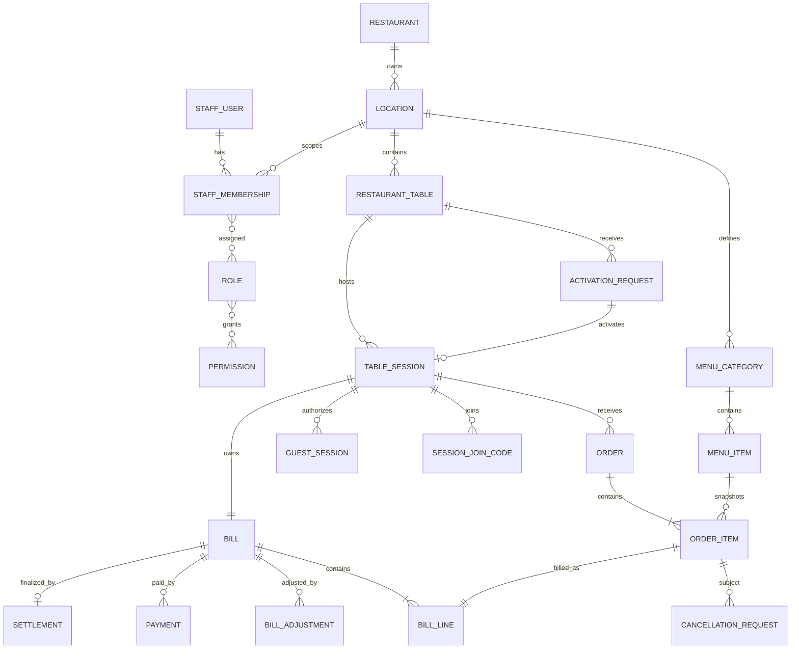

# Relational data model

Status: **APPROVED implemented baseline through M2.6**. Physical schema/migrations hiện gồm restaurant/location/table/menu, staff identity/RBAC/session, guest session, activation request, TableSession, Bill, claim recovery hashes, idempotency, outbox và audit persistence. Các domain tables từ M2.7 trở đi tiếp tục là logical baseline cho task tương ứng.

## ERD



## Scope model

Operational tables carry `restaurant_id` và `location_id` where useful. Parent tables expose composite unique keys so child composite foreign keys can enforce same-scope relationships rather than relying only on application filters.

MVP has one restaurant/active location in use. Scope columns vẫn tồn tại từ đầu; future multi-location approval chỉ cần reviewed migration thay MVP-only active-location index và không yêu cầu destructive retrofit cho operational relationships.

M2.1 catalog/table relationships dùng các database guards sau:

- `location.restaurant_id` references `restaurant.id`; `location` exposes unique `(id, restaurant_id)` cho scoped child FKs.
- `restaurant_table(location_id, restaurant_id)` references `location(id, restaurant_id)` và exposes unique `(id, restaurant_id, location_id)` cho future operational children.
- `menu_category(location_id, restaurant_id)` references `location(id, restaurant_id)` và exposes unique `(id, restaurant_id, location_id)`.
- `menu_item(category_id, restaurant_id, location_id)` references `menu_category(id, restaurant_id, location_id)` và exposes unique `(id, restaurant_id, location_id)` cho future snapshots/relationships.
- Client-provided scope không được dùng để bypass các composite FKs hoặc server-side scope resolution.

## Core tables

### Restaurant and location

`restaurant(id, name, status, created_at)`

`location(id, restaurant_id, code, name, timezone, currency, is_active)`

Important constraints:

- Unique `(restaurant_id, code)`.
- Currency là `VND` trong MVP; schema và fixtures không dùng floating-point monetary values.
- Timezone default `Asia/Ho_Chi_Minh`.
- At most one active location per restaurant được enforce bằng PostgreSQL partial unique index:

```sql
CREATE UNIQUE INDEX location_one_active_per_restaurant_idx
ON location (restaurant_id)
WHERE is_active = true;
```

Index này là MVP-only. Không đổi `is_active` hoặc status terminology đã approved; future multi-location support phải thay/drop index qua reviewed migration.

### Physical table

`restaurant_table(id, restaurant_id, location_id, public_id, code, capacity, physical_status, version, is_active)`

- Unique `public_id`; đây là opaque identifier in trong QR, không phải secret.
- Unique `(location_id, code)`.
- `capacity > 0`; `version` mặc định `0` và luôn `>= 0`.
- State-changing update tương lai increment `version` atomically; M2.1 chỉ thiết lập invariant, không thêm table workflow.
- Composite scope FK tới location theo scope model ở trên.

### Activation request

`activation_request(id, restaurant_id, location_id, table_id, requester_guest_session_id, status, expires_at, handled_by_membership_id, handled_at, rejection_reason, version, created_at, updated_at)`

- Partial unique `(table_id) WHERE status = 'PENDING'`.
- Status values: `PENDING`, `APPROVED`, `REJECTED`, `EXPIRED`, `CANCELLED`.
- Default expiry là 5 phút và configurable; read-only query project effective expiry, write-side request command chuyển pending đã hết hạn sang `EXPIRED` trước khi tạo request mới.
- Composite foreign keys enforce cùng restaurant/location/table cho requester guest session và future handler membership.
- Approval/rejection phải ghi handler và thời điểm.
- Guest khác chỉ được đọc waiting state tổng quát, không đọc requester/session secrets.

### Table session

`table_session(id, restaurant_id, location_id, table_id, activation_request_id, status, activated_by_membership_id, activated_at, checkout_locked_at, closed_by_membership_id, closed_at, close_reason, version)`

- Partial unique `(table_id) WHERE status IN ('ACTIVE','CHECKOUT_LOCKED')`.
- Unique `activation_request_id`; composite scoped foreign keys ensure request, table, activating membership và TableSession thuộc cùng restaurant/location.
- M2.6 approval creates status `ACTIVE`, links exactly one TableSession to the approved request, and initializes `version = 0`.
- Không hard-delete.
- Closed fields phải nhất quán với status bằng check/application invariant.

### Guest session

`guest_session(id, restaurant_id, location_id, table_id, table_session_id, token_hash, csrf_token_hash, previous_token_hash, previous_csrf_token_hash, previous_token_valid_until, access_level, idle_expires_at, absolute_expires_at, revoked_at, last_seen_at, created_at, version)`

- Unique `token_hash`; không lưu raw token.
- `csrf_token_hash` lưu SHA-256 hash của synchronizer CSRF token.
- Composite foreign key `(table_id, restaurant_id, location_id)` tham chiếu `restaurant_table(id, restaurant_id, location_id)`.
- `ORDER_ENABLED` yêu cầu non-null `table_session_id` trong tương lai; ở M2.4, `table_session_id` là nullable column và foreign key vật lý được hoãn (deferred) cho đến khi `table_session` được tạo ở milestone sau.
- M2.6 tạo scoped foreign key cho `table_session_id`; claim chỉ bind requester session vào TableSession đã được tạo từ chính activation request của nó.
- Ba `previous_*` fields là all-null hoặc all-non-null; chỉ chứa hashes và recovery deadline. Chúng chỉ hỗ trợ requester claim retry trong 120 giây, không phải general guest authentication.
- Guest session gắn chặt vào table và không được chuyển sang table khác. Safe reuse/refresh trên cùng một bàn tái sử dụng session hợp lệ thay vì tạo duplicate records.

### Session join code

`session_join_code(id, table_session_id, code_hash, expires_at, revoked_at, created_by_guest_session_id, created_by_membership_id)`

- Exactly one creator.
- Tối đa một unrevoked code mỗi TableSession.
- Không dùng predicate dựa vào `now()` trong partial index; expired code phải được revoke/replace trong command transaction.

### Staff authorization

- `staff_user(id, email, password_hash, name, status)`
- `staff_membership(id, staff_user_id, restaurant_id, location_id, status)`
- `role(id, restaurant_id, code, name, is_system)`
- `permission(id, code)`
- `membership_role(membership_id, role_id)`
- `role_permission(role_id, permission_id)`
- `staff_session(id, staff_user_id, membership_id, token_hash, csrf_token_hash, expires_at, revoked_at, created_at)`

Important constraints:

- `staff_user.email` unique, trimmed lowercase và non-empty; password field chỉ lưu encoded salted `scrypt` hash.
- Staff user status là `ACTIVE|INACTIVE`; membership status là `ACTIVE|INACTIVE|REVOKED` để disable tạm thời hoặc thu hồi scope rõ ràng.
- Unique `(staff_user_id, location_id)`; effective permissions là union của roles trên active membership.
- Composite membership/location FK enforce membership restaurant/location scope; `membership_role` chứa `restaurant_id` để composite FKs chặn role từ restaurant khác.
- `staff_session(membership_id, staff_user_id)` references đúng membership/user pair; session không thể bind membership của user khác.
- Session và CSRF token chỉ lưu lowercase SHA-256 hash 64 ký tự; raw token không persistence.
- `expires_at > created_at`; `revoked_at` null hoặc không trước `created_at`. Application đặt absolute expiry đúng 8 giờ và không rolling refresh.

### Menu

- `menu_category(id, restaurant_id, location_id, name, display_order, status)`
- `menu_item(id, restaurant_id, location_id, category_id, name, description, price_amount, fulfillment_station, status, version)`

`price_amount` là integer VND lưu bằng `BIGINT` với check `price_amount >= 0`; không dùng floating point. `menu_item.version` mặc định `0` và luôn `>= 0`. Historical usage ngăn hard-delete menu item.

### M2 fixtures

- Cho phép deterministic, synthetic restaurant/location/table/menu fixtures cho local, test và public portfolio demo.
- Fixtures có thể dùng stable synthetic IDs/codes/public table IDs để rerun không tạo duplicate; static table `public_id` vẫn chỉ là public identifier, không phải credential.
- Không chứa real credential, secret, personal information hoặc dữ liệu người thật.
- Không tạo staff password/session, guest credential hoặc join code trong M2.1 catalog fixtures.
- Fixture loading là explicit owner/developer operation, không chạy ngầm trong migration hoặc application startup.

### Order and item snapshots

`order(id, restaurant_id, location_id, table_session_id, order_number, source, created_by_guest_session_id, created_by_membership_id, status, submitted_at, version)`

- Unique `(location_id, order_number)`.
- Exactly one actor, tương ứng `QR_GUEST` hoặc `STAFF_WAITER`.

`order_item(id, order_id, menu_item_id, name_snapshot, unit_price_amount, quantity, modifiers_snapshot, note, station_snapshot, status, cancellation_reason, cancelled_by_membership_id, preparing_at, ready_at, served_at, cancelled_at, version)`

- `quantity > 0`, price không âm.
- Snapshot fields immutable sau submit.
- Terminal operational records không bị xóa.

### Cancellation request

`cancellation_request(id, restaurant_id, location_id, table_session_id, order_item_id, requested_by_guest_session_id, requested_by_membership_id, status, stage_at_request, reason, forwarded_by_membership_id, decided_by_membership_id, decision_reason, decided_at, version)`

- Exactly one requester.
- Partial unique unresolved request per item.
- Kitchen decision chỉ hợp lệ với request được forward và item `PREPARING`.

### Bill and adjustments

`bill(id, restaurant_id, location_id, table_session_id, status, subtotal_amount, adjustment_amount, total_amount, paid_amount, balance_amount, version)`

- Unique `table_session_id`.
- `total = subtotal + adjustment`; `balance = total - paid`.
- `SETTLED` yêu cầu balance bằng 0.
- M2.6 approval creates exactly one `OPEN` Bill with all monetary totals `0` and `version = 0`; it creates no BillLine, adjustment, payment or settlement.

`bill_line(id, bill_id, order_item_id, description_snapshot, quantity, unit_amount, line_amount)`

- Unique `order_item_id`.
- Immutable.

`bill_adjustment(id, bill_id, order_item_id, type, amount, reason, policy_code, approved_by_membership_id, created_at)`

- Waiver amount âm.
- MVP chỉ có full waiver; correction tạo record đối ứng thay vì update lịch sử.
- Policy waiver cho approved cancellation phải reference item và cancellation reason/record.

### Payment and settlement

`payment(id, bill_id, method, status, amount, recorded_by_membership_id, external_reference, failure_reason, version)`

`settlement(id, bill_id, settled_amount, settled_at, created_by_membership_id)`

- Unique settlement `bill_id` trong MVP.
- Cash payment, bill settled và settlement record commit atomically.

## Reliability tables

### Idempotency

`idempotency_record(id, restaurant_id, actor_type, actor_id, operation, idempotency_key, request_hash, status, response_status, response_body, resource_id, expires_at)`

Unique `(actor_type, actor_id, operation, idempotency_key)`.

M2.5 triển khai subset generic tối thiểu cho operation `REQUEST_ACTIVATION`. M2.6 extends operations with `APPROVE_ACTIVATION`, `REJECT_ACTIVATION` và `CLAIM_ACTIVATION`: request payload được SHA-256 fingerprint, sanitized response/status commit cùng command transaction, và reuse cùng actor/operation/key với payload khác bị reject. Raw credential/CSRF values không được persist trong response body. Cleanup/retention policy tổng quát vẫn `OPEN`; guest-actor record expire không muộn hơn absolute expiry của guest actor.

### Transactional outbox

`outbox_event(id, restaurant_id, location_id, aggregate_type, aggregate_id, event_type, payload, occurred_at, published_at, attempt_count, next_attempt_at)`

- M2.6 chỉ persist events, chưa có publisher/worker hoặc realtime delivery.
- Approval writes `activation.updated` và `table.session.updated`; rejection writes `activation.updated`. Claim is security-sensitive credential rotation and writes audit only, not an outbox event.
- Payload chỉ chứa scoped resource IDs, status/version và event time; không chứa guest/session credential, CSRF token, requester identifier hoặc rejection detail không cần thiết.
- New events initialize `published_at = null`, `attempt_count = 0`; delivery/retry behavior thuộc milestone sau.

### Audit

`audit_log(id, restaurant_id, location_id, actor_type, actor_id, action, resource_type, resource_id, reason, metadata, created_at)`

- M2.6 actions là `ACTIVATION_APPROVED`, `ACTIVATION_REJECTED` và `GUEST_ACTIVATION_CLAIMED`.
- Approval audit records staff membership actor, physical-presence attestation, request/table/session IDs và before/after versions. Rejection audit records staff membership actor, reason và request versions. Claim audit records requester guest-session actor and linked request/session IDs.
- Audit row commit atomically với command side effects; idempotent replay không tạo duplicate audit.
- Không lưu raw credentials, CSRF tokens, sensitive cookie values hoặc idempotency response secrets trong audit metadata.

## Concurrency approach

- Unique/partial unique indexes là final invariant guard.
- `version` hỗ trợ optimistic concurrency.
- Row locks dùng cho activation, settlement và close-session commands.
- Transition updates phải include expected state/version.
- M2.6 approve/reject acquire locks theo order `restaurant_table → activation_request`; approval sau đó creates TableSession/Bill before reliability rows. Claim locks `activation_request → table_session → requester guest_session`. Mọi relationship/state/version phải được revalidate sau lock.
- Partial unique active TableSession index và unique activation-request link là final guard cho exactly-once creation. Concurrent approve/approve hoặc approve/reject với cùng stale version chỉ cho một transaction transition; transaction còn lại trả `409` và không ghi partial side effects.
- Write-side expiry transition được commit trước khi application trả expired conflict; read-only GET tiếp tục không lazy-write.
- Prisma migrations phải được review; custom SQL được dùng khi schema DSL không biểu đạt đủ constraint.
