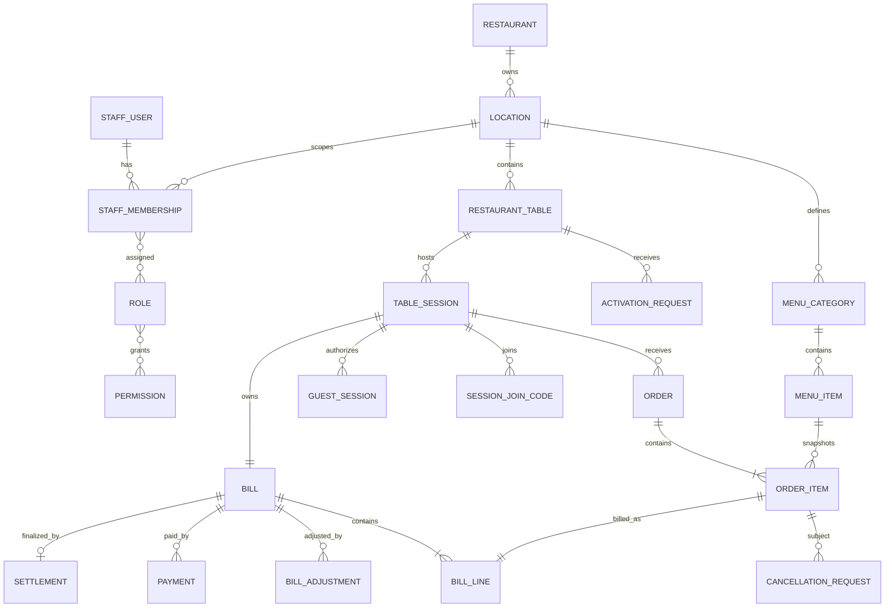

# Relational data model

Status: **APPROVED logical baseline**. M2.1 đã triển khai physical Prisma schema và migration cho restaurant/location/table/menu catalog; các domain tables còn lại tiếp tục là logical baseline cho các task M2–M4 tương ứng.

## ERD



## Scope model

Operational tables carry `restaurant_id` và `location_id` where useful. Parent tables expose composite unique keys so child composite foreign keys can enforce same-scope relationships rather than relying only on application filters.

MVP has one restaurant/active location in use. Scope columns vẫn tồn tại từ đầu; future multi-location approval chỉ cần reviewed migration thay MVP-only active-location index và không yêu cầu destructive retrofit cho operational relationships.

M2.1 catalog/table relationships dùng các database guards sau:

- `location.restaurant_id` references `restaurant.id`; `location` exposes unique `(id, restaurant_id)` cho scoped child FKs.
- `restaurant_table(location_id, restaurant_id)` references `location(id, restaurant_id)` và exposes unique `(id, restaurant_id, location_id)` cho future operational children.
- `menu_category(location_id, restaurant_id)` references `location(id, restaurant_id)` và exposes unique `(id, restaurant_id, location_id)`.
- `menu_item(category_id, restaurant_id, location_id)` references `menu_category(id, restaurant_id, location_id)` và exposes unique `(id, restaurant_id, location_id)` cho future snapshots/relationships.
- Client-provided scope không được dùng để bypass các composite FKs hoặc server-side scope resolution.

## Core tables

### Restaurant and location

`restaurant(id, name, status, created_at)`

`location(id, restaurant_id, code, name, timezone, currency, is_active)`

Important constraints:

- Unique `(restaurant_id, code)`.
- Currency là `VND` trong MVP; schema và fixtures không dùng floating-point monetary values.
- Timezone default `Asia/Ho_Chi_Minh`.
- At most one active location per restaurant được enforce bằng PostgreSQL partial unique index:

```sql
CREATE UNIQUE INDEX location_one_active_per_restaurant_idx
ON location (restaurant_id)
WHERE is_active = true;
```

Index này là MVP-only. Không đổi `is_active` hoặc status terminology đã approved; future multi-location support phải thay/drop index qua reviewed migration.

### Physical table

`restaurant_table(id, restaurant_id, location_id, public_id, code, capacity, physical_status, version, is_active)`

- Unique `public_id`; đây là opaque identifier in trong QR, không phải secret.
- Unique `(location_id, code)`.
- `capacity > 0`; `version` mặc định `0` và luôn `>= 0`.
- State-changing update tương lai increment `version` atomically; M2.1 chỉ thiết lập invariant, không thêm table workflow.
- Composite scope FK tới location theo scope model ở trên.

### Activation request

`activation_request(id, restaurant_id, location_id, table_id, requester_guest_session_id, status, expires_at, handled_by_membership_id, handled_at, rejection_reason, version)`

- Partial unique `(table_id) WHERE status = 'PENDING'`.
- Approval/rejection phải ghi handler và thời điểm.
- Guest khác chỉ được đọc waiting state tổng quát, không đọc requester/session secrets.

### Table session

`table_session(id, restaurant_id, location_id, table_id, status, activated_by_membership_id, activated_at, checkout_locked_at, closed_by_membership_id, closed_at, close_reason, version)`

- Partial unique `(table_id) WHERE status IN ('ACTIVE','CHECKOUT_LOCKED')`.
- Không hard-delete.
- Closed fields phải nhất quán với status bằng check/application invariant.

### Guest session

`guest_session(id, restaurant_id, location_id, table_id, table_session_id, token_hash, access_level, idle_expires_at, absolute_expires_at, revoked_at, last_seen_at, version)`

- Unique `token_hash`; không lưu raw token.
- `ORDER_ENABLED` yêu cầu non-null `table_session_id`.
- Guest session không được chuyển sang table/table session khác.

### Session join code

`session_join_code(id, table_session_id, code_hash, expires_at, revoked_at, created_by_guest_session_id, created_by_membership_id)`

- Exactly one creator.
- Tối đa một unrevoked code mỗi TableSession.
- Không dùng predicate dựa vào `now()` trong partial index; expired code phải được revoke/replace trong command transaction.

### Staff authorization

- `staff_user(id, email, password_hash, name, status)`
- `staff_membership(id, staff_user_id, restaurant_id, location_id, status)`
- `role(id, restaurant_id, code, name, is_system)`
- `permission(id, code)`
- `membership_role(membership_id, role_id)`
- `role_permission(role_id, permission_id)`

Unique `(staff_user_id, location_id)`; effective permissions là union của roles trên active membership.

### Menu

- `menu_category(id, restaurant_id, location_id, name, display_order, status)`
- `menu_item(id, restaurant_id, location_id, category_id, name, description, price_amount, fulfillment_station, status, version)`

`price_amount` là integer VND lưu bằng `BIGINT` với check `price_amount >= 0`; không dùng floating point. `menu_item.version` mặc định `0` và luôn `>= 0`. Historical usage ngăn hard-delete menu item.

### M2 fixtures

- Cho phép deterministic, synthetic restaurant/location/table/menu fixtures cho local, test và public portfolio demo.
- Fixtures có thể dùng stable synthetic IDs/codes/public table IDs để rerun không tạo duplicate; static table `public_id` vẫn chỉ là public identifier, không phải credential.
- Không chứa real credential, secret, personal information hoặc dữ liệu người thật.
- Không tạo staff password/session, guest credential hoặc join code trong M2.1 catalog fixtures.
- Fixture loading là explicit owner/developer operation, không chạy ngầm trong migration hoặc application startup.

### Order and item snapshots

`order(id, restaurant_id, location_id, table_session_id, order_number, source, created_by_guest_session_id, created_by_membership_id, status, submitted_at, version)`

- Unique `(location_id, order_number)`.
- Exactly one actor, tương ứng `QR_GUEST` hoặc `STAFF_WAITER`.

`order_item(id, order_id, menu_item_id, name_snapshot, unit_price_amount, quantity, modifiers_snapshot, note, station_snapshot, status, cancellation_reason, cancelled_by_membership_id, preparing_at, ready_at, served_at, cancelled_at, version)`

- `quantity > 0`, price không âm.
- Snapshot fields immutable sau submit.
- Terminal operational records không bị xóa.

### Cancellation request

`cancellation_request(id, restaurant_id, location_id, table_session_id, order_item_id, requested_by_guest_session_id, requested_by_membership_id, status, stage_at_request, reason, forwarded_by_membership_id, decided_by_membership_id, decision_reason, decided_at, version)`

- Exactly one requester.
- Partial unique unresolved request per item.
- Kitchen decision chỉ hợp lệ với request được forward và item `PREPARING`.

### Bill and adjustments

`bill(id, restaurant_id, location_id, table_session_id, status, subtotal_amount, adjustment_amount, total_amount, paid_amount, balance_amount, version)`

- Unique `table_session_id`.
- `total = subtotal + adjustment`; `balance = total - paid`.
- `SETTLED` yêu cầu balance bằng 0.

`bill_line(id, bill_id, order_item_id, description_snapshot, quantity, unit_amount, line_amount)`

- Unique `order_item_id`.
- Immutable.

`bill_adjustment(id, bill_id, order_item_id, type, amount, reason, policy_code, approved_by_membership_id, created_at)`

- Waiver amount âm.
- MVP chỉ có full waiver; correction tạo record đối ứng thay vì update lịch sử.
- Policy waiver cho approved cancellation phải reference item và cancellation reason/record.

### Payment and settlement

`payment(id, bill_id, method, status, amount, recorded_by_membership_id, external_reference, failure_reason, version)`

`settlement(id, bill_id, settled_amount, settled_at, created_by_membership_id)`

- Unique settlement `bill_id` trong MVP.
- Cash payment, bill settled và settlement record commit atomically.

## Reliability tables

### Idempotency

`idempotency_record(id, restaurant_id, actor_type, actor_id, operation, idempotency_key, request_hash, status, response_status, response_body, resource_id, expires_at)`

Unique `(actor_type, actor_id, operation, idempotency_key)`.

### Transactional outbox

`outbox_event(id, aggregate_type, aggregate_id, event_type, payload, occurred_at, published_at, attempt_count, next_attempt_at)`

### Audit

`audit_log(id, restaurant_id, location_id, actor_type, actor_id, action, resource_type, resource_id, reason, metadata, created_at)`

Không lưu raw credentials hoặc sensitive cookie values trong audit metadata.

## Concurrency approach

- Unique/partial unique indexes là final invariant guard.
- `version` hỗ trợ optimistic concurrency.
- Row locks dùng cho activation, settlement và close-session commands.
- Transition updates phải include expected state/version.
- Prisma migrations phải được review; custom SQL được dùng khi schema DSL không biểu đạt đủ constraint.
